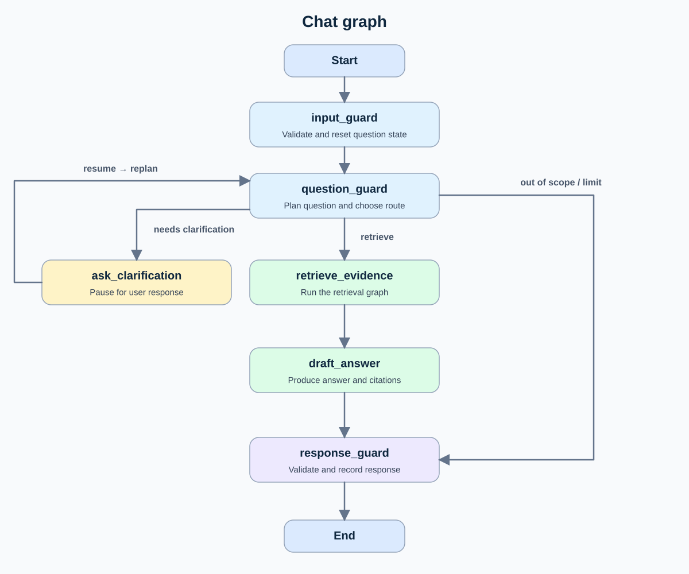
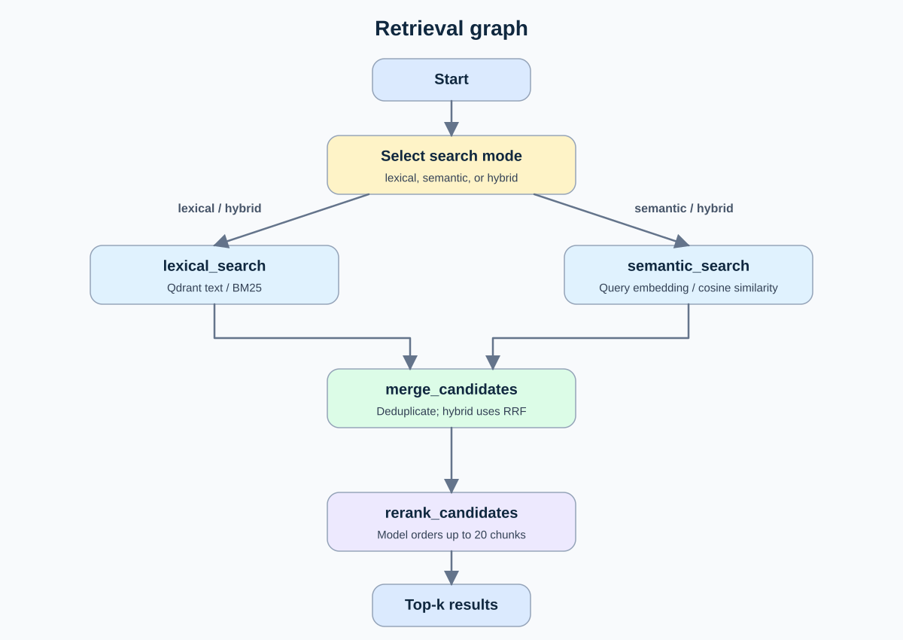

# Roads and Transport Knowledge Assistant

A local FastAPI project for answering questions from a bounded collection of Dubai legislation. The project includes PDF ingestion, lexical and semantic retrieval, and a LangGraph flow with hybrid search and LLM reranking. It also provides cited answers and persistent conversation threads.

For a spoken walkthrough with file-opening cues, evaluation results, and evidence-based conclusions, see the [code review presentation script](docs/code-review-script.md).

## Architecture graphs

The chat graph routes a question through planning, clarification when needed, retrieval, answer drafting, and final validation. Its `retrieve_evidence` node calls the retrieval graph below.



The retrieval graph runs lexical search, semantic search, or both in hybrid mode. It merges candidates and reranks them before returning the requested top results.



## Agent flow and shared state

The [chat graph](app/agents/chat.py) is the conversation orchestrator. `run_chat()` invokes it for `/chat` or resumes a pending clarification for `/chat/resume`. The graph passes one typed [ChatState](app/agents/chat_models.py) between its nodes: request, request ID, history, query plan, clarifications, retrieved evidence, answer draft, and final response. LangGraph checkpoints this state in `data/checkpoints.sqlite` under `thread_id`, so follow-ups and interrupted conversations can continue on the same thread.

| Chat node | What it does |
| --- | --- |
| `input_guard` | Validates the request and clears the previous question's plan, evidence, draft, response, and clarification replies; it keeps conversation history. |
| `question_guard` | Uses the chat model to produce a Pydantic `QueryPlan`. It turns follow-ups into standalone search queries and chooses `retrieve`, `out_of_scope`, or `needs_clarification`. |
| `ask_clarification` | Calls LangGraph `interrupt()` and returns a question to the client. On `/chat/resume`, it records the reply and loops back to `question_guard`. The flow allows up to two replies. |
| `retrieve_evidence` | Calls the retrieval graph with the planned query, requested mode, filters, and `top_k`, then stores its final chunks as evidence. |
| `draft_answer` | Runs a LangChain answer agent on that evidence and returns a structured `AnswerDraft` with an answer and citations, or `insufficient_evidence`. |
| `response_guard` | Creates the final status, checks that each citation identifies a selected chunk and locator, and appends the exchange to history. A matching citation identifier is not itself proof that every claim is supported. |

The [LangChain answer agent](app/agents/answer_agent.py) runs *inside* the `draft_answer` LangGraph node. It uses `create_agent()` with the configured chat model, a model-callable `get_document_excerpt(document_id, locator)` tool, and `ToolStrategy(AnswerDraft)` for structured output. The tool only reads chunks selected by retrieval. Middleware logs model-call duration and limits the agent to four model calls and four excerpt calls. The planning, answer, and reranking instructions live in separate files under [app/agents/prompts/](app/agents/prompts/).

The [retrieval graph](app/agents/retrieval_graph.py) searches the indexed corpus and returns ranked chunks. Its temporary [RetrievalState](app/agents/retrieval_nodes.py) holds the request, separate branch results, merged candidates, and final results for one run; it is not checkpointed. `select_search_branches()` is the routing function at the graph's start, not a node: it starts the lexical branch, the semantic branch, or both for hybrid mode.

| Retrieval node | Input and action | Output / model use |
| --- | --- | --- |
| `lexical_search` | Searches Qdrant's text index for matching words and ranks chunks with BM25. | Writes `lexical_results`; no AI model call. |
| `semantic_search` | Embeds the query and compares it with indexed chunk vectors using cosine similarity. | Writes `semantic_results`; calls the embedding model for the query. |
| `merge_candidates` | Waits for the active search branch or both hybrid branches, removes duplicate chunk IDs, and keeps at most 20 candidates. In hybrid mode it combines ranks with RRF: `1 / (60 + rank)` from each list. | Writes `candidates` and `before_rerank`; no model call. |
| `rerank_candidates` | Sends the question and candidate passages to the chat model, which returns their relevance order, then selects the requested `top_k`. | Writes `results` and `after_rerank`; uses the [reranking prompt](app/agents/prompts/rerank_candidates.py). |

In **hybrid** mode the graph fans out to `lexical_search` and `semantic_search` in parallel. They write different state keys, so their results do not overwrite each other. LangGraph then runs `merge_candidates` once after both finish; one reranking pass follows. In a single search mode, only its chosen search node runs before the same merge and rerank nodes. Each active branch asks search for `max(10, top_k)` candidates; fewer may match the query or filters. Reranking changes the result order, but the displayed numeric score remains its original BM25, cosine, or RRF retrieval score.

`retrieve_evidence` copies those final chunks into `ChatState`; the answer agent then uses them to draft the cited response. The search graph's `trace`, `before_rerank`, and `after_rerank` fields show which nodes ran and how candidate order changed.

## Run locally

Install [uv](https://docs.astral.sh/uv/getting-started/installation/) and use Python 3.11 or newer. From this directory:

```sh
uv sync --frozen
uv run uvicorn app.main:app --host 127.0.0.1 --port 8000
```

Open `http://127.0.0.1:8000/docs` for the generated OpenAPI page. Check the service with:

```sh
curl http://127.0.0.1:8000/health
```

`ready` reports that the API is running. `index_available` becomes `true` after ingestion has stored at least one chunk. The PDFs alone are not an index.

## Model configuration

The project has an ignored `.env` file for the Azure AI Foundry OpenAI-compatible endpoint. `OPENAI_BASE_URL` and `OPENAI_API_KEY` are shared by both deployments; `CHAT_MODEL` names the chat deployment and `EMBEDDING_MODEL` names the embedding deployment. Copy `.env.example` when setting up another machine and supply that machine's key. Ingestion embeds missing chunks with `text-embedding-3-small`. Semantic search uses the same deployment to embed each query. Lexical retrieval runs locally. All nonempty searches use `gpt-4.1-mini` to rerank the candidates. Chat also uses it for query planning and the answer agent.

## Corpus

`data/pdfs/` contains exactly 30 local English PDF files downloaded from the [Dubai Legislation Portal search page](https://dlp.dubai.gov.ae/en/Pages/LegislationSearch.aspx) on 2026-11-10. They were selected from results after setting the **Primary** category to **Roads and Transport** (portal value `25`). The filtered portal response reported 45 results. The selected set includes vehicle inspection, parking, autonomous vehicles, driving instruction, public transport, maritime services, railways, airports, taxis, and tolls. It includes resolutions, laws, and a regulation across multiple years. The PDFs are ignored by Git until redistribution rights are confirmed; the manifest retains their official download URLs.

`data/manifest.csv` lists each selected document's portal ID, title, official HTML viewer URL, PDF URL, category, language, retrieval date, available legislation metadata, local filename, and SHA-256 hash. `data/evidence/roads_and_transport_filtered_results.html` is the saved filtered portal result page; its selected primary-category option and all 30 selected result IDs can be checked directly.

To obtain the PDFs for local research on a fresh checkout, run `uv run python scripts/download_pdfs.py`. The script downloads each file from its official manifest URL, verifies its SHA-256 hash, and skips files that already match. The portal's [terms](https://dlp.dubai.gov.ae/en/Pages/TermsAndConditions.aspx) permit personal use or research but require express prior written consent before redistribution, so the PDFs remain outside Git.

The portal's `status` field is copied as source metadata. It should not be treated as independent verification of current legal applicability. This corpus is a selected sample, not an exhaustive or current legal compilation.

## Ingest the corpus

Run the server, then call:

```sh
curl -X POST http://127.0.0.1:8000/ingest
```

The response reports indexed, skipped, and failed document counts, chunks written, embeddings written, errors, and warnings. The local Qdrant index in `data/qdrant/` contains 30 documents and 1,136 chunks: 726 prose chunks and 410 table chunks. Each point holds the chunk text, metadata, and its embedding. The old `data/index.sqlite` is retained as an unused backup. The older run results in `data/ingestion_report.json` are historical examples from before table-aware ingestion.

The parser removes repeated page headers and copyright footers, then starts a prose chunk at each numbered article. A short article stays whole. Long articles are split into pieces of at most **800 characters**, including the repeated article heading and number. Adjacent pieces of the same article share approximately **80 characters** of text. The preamble remains a separate section. Each chunk stores its document ID, section type, article number where present, and start/end PDF pages. The three records in `data/chunk_examples.json` show the earlier prose-only format.

For the 13 documents with substantive schedules, `app/rag/table_chunks.py` extracts table rows separately. Each `table` chunk repeats the schedule title, the PDF page, and the labels needed to read its values. Fee and fine rows keep the description and amount together. Parking chunks name the on-street/off-street and peak-hour columns. Tourist classification chunks name the star category. Water taxi fare chunks keep one origin station with all its destination fares. Prose outside table boundaries remains in article chunks. Two descriptions that continue onto the next page have a two-page locator. The vessel crew matrices retain row labels and printed symbols by column number; their nested column meanings still require checking against the PDF before answering precise crew-composition questions.

Pages 4–6 of document `1941` contain maps. Their visual content is not indexed; the ingestion response warns about these pages. Do not rely on the text index for map-specific answers. Verify complex table values against the cited PDF page.

After parsing, `/ingest` embeds changed documents in batches of 64 and writes their chunks to Qdrant. It skips documents whose PDF hash and stored chunk count still match. A repeated run on this corpus writes zero new embeddings. If ingestion of a changed document fails, its previous points remain until the new embeddings are ready; retry the request to finish indexing. One ingestion request runs at a time in the local server process.

The Qdrant collection records the embedding endpoint and deployment. A different deployment cannot be mixed into the same collection. If the model behind the same deployment name changes, deliberately rebuild the index to avoid mixing old and new vectors.

For a deliberate full rebuild after changing the parser or embedding model, stop the backend, delete `data/qdrant/`, restart the backend, and call `/ingest` again. Qdrant runs in embedded local mode, so no Docker container is needed. Use one backend process with this local index. The index is generated data and ignored by Git.

## Search the chunks

All three modes use the same endpoint and return ranked chunks with document title, source/PDF URLs, category, year, type, status, article number, and PDF page locator. Search retrieves evidence; it does not generate an answer.

```sh
curl -X POST http://127.0.0.1:8000/search \
  -H 'Content-Type: application/json' \
  -d '{"query":"What permits are required to operate autonomous vehicles?","mode":"lexical"}'

curl -X POST http://127.0.0.1:8000/search \
  -H 'Content-Type: application/json' \
  -d '{"query":"What permits are required to operate autonomous vehicles?","mode":"semantic","filters":{"year":2023,"type":"Law"}}'
```

- `query`: nonblank text, up to 2,000 characters.
- `mode`: `lexical` (default), `semantic`, or `hybrid`.
- `top_k`: integer from 1 to 20, default 10. This counts chunks, so one document can appear several times.
- `filters`: optional exact `year` (integer, 1900–2100) and `type` (`Law`, `Resolution`, or `Regulation`). Combined filters use AND. All modes always require English and the Roads and Transport primary category. Filters apply before choosing the top results.

### Lexical strategy: Qdrant text search with BM25

`lexical_search()` extracts unique query words, removes a small list of common words, and sends the remaining terms to Qdrant's scored text index. A chunk can match some of the query words instead of requiring every query word. Text matching does not infer synonyms or understand meaning.

Qdrant ranks matching chunks with BM25. Its scores are sorted descending: **higher is better**. Lexical retrieval requires no Azure call, though reranking does. The response labels this as `score_type: bm25`, `score_direction: higher_is_better`. Rankings and numeric scores can differ from the old SQLite index.

### Semantic strategy: Qdrant vector search

`embed_texts()` sends chunk text to the configured Azure embedding deployment during indexing. It validates and normalizes each vector before storing it in Qdrant. During search, `semantic_search()` embeds the query and sends it to Qdrant with the metadata filters. Qdrant ranks eligible vectors by cosine similarity. Higher scores mean closer semantic similarity. It may find related wording without shared keywords, but it does not guarantee that a result answers the question. It returns the closest chunks without a calibrated relevance threshold.

The response labels semantic scores as `cosine_similarity` and `higher_is_better`. Successful reranking reports `ranking_stage: reranked`; empty results or a reranker failure report `ranking_stage: retrieval`. The returned scores remain retrieval scores, not reranker scores, percentages, or confidence in a legal answer. Do not compare BM25 values directly with cosine values.

If metadata filters match no chunks, the response contains `results: []`; semantic search then makes no embedding call. Missing indexes or model configuration produce HTTP 503, embedding failures produce 502, and invalid request fields produce 422. Reranker failures preserve the original retrieval order. Concurrent ingestion requests receive 409. `/health` reports chunk availability, not separate semantic-index readiness.

### Hybrid and reranking

The typed LangGraph retrieval flow routes to lexical, semantic, or both nodes in parallel. Each branch fetches at least 10 candidates, or `top_k` when larger. The join deduplicates by chunk ID. Hybrid combines ranks with reciprocal rank fusion: each occurrence contributes `1 / (60 + rank)`. It keeps at most 20 candidates for reranking.

The reranker sends the question and candidate text to the configured chat model in one JSON request. The model returns all candidate IDs in relevance order; the code validates the response as a complete permutation. If the response is malformed, contains duplicate/missing/invalid IDs, or the reranking provider call fails, the node logs the reason and preserves the existing BM25, cosine, or RRF candidate order. It returns at most `top_k` chunks, and chat can continue to its answer agent and citation checks. This fallback may produce a less relevant order, but does not invent or remove source passages. It does not hide embedding, planning, or answer-generation failures. Missing configuration still produces an error.

A no-match search does not call the reranker. The response includes `trace`, `before_rerank`, and `after_rerank` chunk IDs so the flow and ranking changes can be inspected. On fallback, `ranking_stage` is `retrieval` and the before/after lists match; on successful model reordering it is `reranked`. The `score` on each result is still the original BM25, cosine, or RRF retrieval score; it does not describe the rerank order. Scores are not confidence values.

```sh
curl -X POST http://127.0.0.1:8000/search -H 'Content-Type: application/json' \
  -d '{"query":"What permits are required to operate autonomous vehicles?","mode":"hybrid","top_k":10}'
```

`data/day4_trace.json` records a real run in all three modes, including the pre- and post-rerank order. This is an example, not a retrieval-quality benchmark.

## Chat with citations

```sh
curl -X POST http://127.0.0.1:8000/chat \
  -H 'Content-Type: application/json' \
  -d '{"thread_id":"conversation_1","message":"What permits are required to operate autonomous vehicles?","mode":"hybrid","top_k":10}'
```

Send follow-up questions with the same `thread_id`. A different ID has a separate history. Thread IDs contain letters, digits, underscores, or hyphens and have at most 100 characters. `mode`, `top_k`, and `filters` match `/search`; chat defaults to hybrid and ten results. Checkpoints are persisted in the ignored `data/checkpoints.sqlite` file.

The typed parent graph clears question-specific state, asks the model for a structured query plan, routes out-of-scope or unclear questions, invokes retrieval for in-scope questions, uses a LangChain answer agent, then validates its structured response. `get_document_excerpt(document_id, locator)` only returns selected indexed chunks and the agent middleware logs model-call timings. Citations must match a selected chunk ID, document ID, and PDF locator. If the model reports insufficient support, no evidence is retrieved, or the citation check fails, the response is `insufficient_evidence`. Citation validation confirms identifiers and locators; it does not prove that every claim is supported, so review the cited text.

Response fields are `thread_id`, `request_id`, `status`, `answer`, `citations`, and `clarification`. Model and retrieval progress appears in the server terminal. `data/day5_examples.json` records example runs, the model-issued excerpt call, and middleware timing logs; the examples do not establish accuracy across all questions.

## Clarification and API controls

An ambiguous question pauses the graph using a LangGraph `interrupt()`. The HTTP request finishes immediately after the pause; the graph state and pending interrupt stay in SQLite. The response contains `status: "needs_clarification"`, a `clarification` question, and an `interrupt_id`. There is no answer or evidence search at this point.

```sh
curl -X POST http://127.0.0.1:8000/chat \
  -H 'Content-Type: application/json' \
  -d '{"thread_id":"clarification_demo","message":"What permit do I need for it?"}'

# Replace the placeholder with the interrupt_id from the response above.
curl -X POST http://127.0.0.1:8000/chat/resume \
  -H 'Content-Type: application/json' \
  -d '{"thread_id":"clarification_demo","interrupt_id":"PASTE_RETURNED_ID","message":"Operating autonomous vehicles in Dubai."}'
```

`run_chat()` loads the checkpoint for that thread and checks that its pending interrupt matches the supplied ID before invoking `Command(resume={interrupt_id: reply})`. A wrong thread, wrong/stale ID, or completed thread returns HTTP 409 with `invalid_resume`. A new `/chat` question cannot overwrite a pending clarification: it returns 409 with `clarification_pending`.

`ask_clarification()` only reads state and creates the question before `interrupt()`. It records the reply after the interrupt returns, because LangGraph reruns this node from the beginning on resume. The query planner then sees the original question, clarification replies, and recent conversation history. The original search mode, filters, and `top_k` remain in the checkpoint. This follows the [LangGraph interrupt guidance](https://docs.langchain.com/oss/python/langgraph/interrupts).

```text
validate input → plan
                  ├─ unrelated → validate response → end
                  ├─ ambiguous → interrupt → /chat/resume → plan
                  ├─ still ambiguous after two replies → insufficient_evidence
                  └─ clear → retrieve → answer → validate response → end
```

At most two clarification replies are accepted per original question. If the planner still cannot resolve it after the second reply, the graph ends with `insufficient_evidence`, a null answer, and no citations. A new question resets the clarification count and clears old evidence/drafts. Completed history includes the clarification replies so later follow-ups can use them.

`reserve_thread()` atomically reserves each active thread ID using a small lock and set. An overlapping request for that ID returns HTTP 409 (`thread_busy`); requests for other IDs can run concurrently. The reservation is removed in `finally`, including on failures and interrupts. **Run one Uvicorn worker/process**, as in the startup command: the reservation is in memory and does not coordinate multiple processes. SQLite stores durable conversation state; it does not provide user authentication. Thread IDs identify conversations, not authenticated users.

| Bound | Value |
| --- | --- |
| Question or clarification reply | 1–2,000 characters, nonblank |
| Final retrieval results | Default 10; configurable 1–20 |
| Candidates sent to reranking | At most 20 |
| Clarification replies per question | 2 |
| Answer-agent model calls | At most 4 |
| Answer-agent excerpt tool calls | At most 4, including parallel batches |
| Planner, answer, and reranking model timeout | 60 seconds per SDK attempt |
| Embedding timeout | 30 seconds per SDK attempt |
| SDK retries | At most 1 retry per model call |
| SQLite checkpoint lock wait | 10 seconds |

The call limits use LangChain's actual `ModelCallLimitMiddleware` and `ToolCallLimitMiddleware`; exceeding a limit stops the agent and produces a controlled error. The excerpt limit applies to `get_document_excerpt`; the structured-answer tool is governed by the model-call limit. Graph recursion limits provide an additional guard. Timeouts apply to individual SDK network operations/attempts, not a single wall-clock deadline for the whole chat request, which may involve several model calls and retries.

Both chat endpoints use the same response shape on success, clarification, and errors. `interrupt_id` and `error` are additional nullable fields. Errors contain `status: "error"`, an `error.code`, an `error.message`, a null answer/clarification, and empty citations. Invalid JSON or an invalid/missing thread ID returns `thread_id: null`. Every response carries a fresh request ID, also in the `X-Request-ID` header. Raw model/provider exception text is not returned to clients.

| HTTP status | Error |
| --- | --- |
| 409 | Busy thread, pending clarification, or invalid resume |
| 422 | Invalid message, filter, mode, `top_k`, or resume body |
| 503 | Unavailable index/configuration or storage |
| 502 | Model/structured-output failure or agent call limit |
| 504 | Direct model timeout |
| 500 | Sanitized fallback for unexpected failures |

Embedding failures, including wrapped provider timeouts, produce a controlled 502 error. Reranking provider/output failures log a fixed reason and exception type, then preserve retrieval order. Other chat model failures log the request ID and exception types without provider response bodies or credentials. Pause/resume logs include thread ID, request ID, interrupt ID, and attempt; retrieval nodes and the answer middleware keep their existing logs.

Search strategies remain in `app/rag/search.py` and `app/agents/retrieval_nodes.py`: lexical uses Qdrant BM25 word matches; semantic embeds the question and uses Qdrant cosine vector search; hybrid runs both nodes in parallel and adds `1 / (60 + rank)` contributions per chunk ID. With default `top_k=10`, each branch retrieves up to 10 candidates, hybrid merges at most 20 unique candidates, and a single LLM reranking call selects up to 10 final chunks. A single-mode search also uses the same reranker. The returned numeric score remains its retrieval score, not a new LLM confidence score. Clarification happens before this pipeline so it searches the clarified standalone question.

## Verification

```sh
uv run python -m unittest discover -s tests -v
```

The deterministic tests use temporary Qdrant collections and SQLite checkpoints with model substitutes. They cover search/filtering, hybrid routing and deduplication, history isolation, citation validation, and per-question state reset. Additional tests cover separate-process interrupt/resume, wrong-thread/stale/no-pending rejection, two-attempt exhaustion, concurrent thread checks, error envelopes, lock release after failure, and actual agent middleware enforcement of model/tool limits.

After the reranker fallback fix on 2026-11-25, all 36 tests passed. A live Azure `/chat` check of “What permits are required to operate autonomous vehicles in Dubai?” with hybrid search, `top_k=20`, and no filters returned HTTP 200, status `answered`, and four citations (request `7471e3c8-59d7-48a8-a61c-3daa799e1fdd`). This single-request check does not establish answer accuracy or show whether the reranker fallback was used; the deterministic tests exercise that failure path explicitly.

`data/day6_examples.json` records a live Azure model question that paused, then resumed to a cited answer after restarting Uvicorn (different server process IDs). It also records 409 responses for a wrong-thread resume and a repeated resume after completion.

The evidence and reranking paths use explicit local names for selected chunk IDs, allowed citations, search hits, and reciprocal-rank scores. The Qdrant migration changes lexical scores and may change retrieval order; the archived example files below describe the earlier SQLite index and are retained as historical records.

`data/search_examples.json` contains real results for two questions in both modes using the Azure deployment. Year-only, type-only, combined, and no-match filters were also checked against the actual corpus. These checks demonstrate the implementation; they are not a comprehensive retrieval-quality benchmark.

### Section 9 acceptance evidence

With the configured Azure credentials and indexed PDF corpus, run:

```sh
uv run python -m scripts.run_acceptance
```

The runner uses a temporary API process on port 8011 and writes raw [results](evidence/acceptance/results.json), test output, and server traces under `evidence/acceptance/`. The fixed ten questions and expected document/chunk references are in `evidence/acceptance/questions.json`. Review [the acceptance checklist](evidence/acceptance/checklist.md) and [the score and evaluation report](evidence/acceptance/evaluation_report.md) alongside those results. The report records first-attempt failures separately from retries; model-dependent outcomes can change on later runs.

### Ragas answer evaluation

Stop the backend first to release the embedded Qdrant index lock. Run `uv sync --frozen --group eval`, then `uv run --group eval python -m evals.ragas.run`. The 13 cases in [evals/ragas/cases.json](evals/ragas/cases.json) include ten questions with reviewed answers and source references, plus unsupported, unrelated, and ambiguous questions. The runner calls `/chat` with a new thread per case and reads the checkpoint to score the exact chunks selected by the chat graph. It checks expected response status and citation IDs separately, records database identity and the case-file hash, and counts reranker fallbacks without treating empty searches as failures. Restart the backend after evaluation. It also compares the three `/search` modes using the same original questions; those search results are not substituted for chat evidence.

For answered cases, Ragas uses the configured chat model and embedding model to judge five metrics:

| Metric | Meaning |
| --- | --- |
| Faithfulness | Whether the answer's claims follow from selected chunks. |
| Answer correctness | Agreement with the reviewed reference answer. |
| Context precision | Whether useful chunks appear early in the selected list. |
| Context recall | Whether the selected chunks support the reference answer's claims. |
| Answer relevancy | Whether the answer addresses the question, regardless of factual accuracy. |

The new [Qdrant evaluation report](evals/ragas/results/20261125_133409/report.md) records run `20261125_133409` with 30 documents, 1,136 chunks, and final `top_k=5`. All **38 automated tests passed**. The [SQLite baseline](evals/ragas/results/20261111_205750/report.md) remains unchanged; see the [comparison](evals/ragas/results/20261125_133409/comparison.md) for both runs and means over their seven commonly scored cases.

| Measure | Qdrant result |
| --- | ---: |
| Expected status on first attempt | 12/13 cases |
| API/model errors on first attempt | 1/13 cases |
| Expected document in selected chat top 5 | 10/10 answer cases |
| Valid citations to selected chunks | 9/10 answer cases |
| Chat reranker fallbacks | 2, both answered |
| Faithfulness mean | 0.7685 across 9 scored answers |
| Answer correctness mean | 0.7288 across 9 scored answers |
| Context precision mean | 0.9241 across 9 scored answers |
| Context recall mean | 1.0000 across 9 scored answers |
| Answer relevancy mean | 0.9051 across 9 scored answers |

Lexical, semantic, and hybrid each found the expected document in the final top five for **10/10** separate search questions, with no search errors. Hybrid used reranker fallback once. Follow-up continuity and thread isolation passed. Q06 retrieved the expected railway source but failed on both attempts because the answer agent requested five excerpt calls against its limit of four; it has no Ragas scores. Q07 and Q09 answered after malformed reranking responses triggered fallback.

The [source-based review](evals/ragas/results/20261125_133409/review.md) identifies a continuing cross-document attribution problem in Q02 and apparent judge mismatches, particularly Q04's zero faithfulness despite a directly matching fine and Q10's low correctness despite matching the definition. These are estimates on a small corpus-derived set, not general accuracy percentages. The old averages cover eight answers and the new ones cover nine; database behavior and reranker fallback changed together, so the comparison does not isolate Qdrant's causal effect. The next priorities are the excerpt-call failure, source attribution, and broader reviewed cases. See [raw results](evals/ragas/results/20261125_133409/results.json) and the [evaluation guide](evals/ragas/README.md).

## Current structure

- `app/main.py`: small Uvicorn entry point that exposes the FastAPI application.
- `app/api/app.py`: FastAPI routes, request IDs, validation, and controlled errors.
- `app/agents/chat.py`: conversation graph wiring, SQLite checkpoints, and per-thread reservations.
- `app/agents/chat_models.py`: chat request, response, query-plan, and graph-state models.
- `app/agents/chat_nodes.py`: validation, planning, clarification, retrieval handoff, and response validation nodes.
- `app/agents/answer_agent.py`: LangChain answer agent, excerpt tool, middleware, and call limits.
- `app/agents/model.py` and `app/agents/prompts/`: chat model configuration and separate planning, answer, and reranking prompts.
- `tests/test_chat.py`: thread isolation, per-turn reset, and citation validation checks.
- `tests/test_chat_api.py`: durable resume, clarification limits, concurrency, error schemas, and agent call limits.
- `app/agents/retrieval_graph.py`: retrieval graph wiring and trace assembly.
- `app/agents/retrieval_nodes.py`: lexical/semantic searches, RRF join, and LLM reranking.
- `app/rag/search.py` and `app/rag/store.py`: search schemas, Qdrant BM25 and vector search, embeddings, filters, and local collection setup.
- `tests/test_search.py`: isolated search checks.
- `tests/test_reranking.py`: valid reordering, malformed output and provider fallback, truthful ranking-stage reporting, and chat continuation after a failed rerank.
- `data/search_examples.json`: saved real lexical and semantic search results.
- `app/rag/ingest.py` and `app/rag/table_chunks.py`: PDF extraction, chunking, manifest checks, and Qdrant indexing.
- `data/manifest.csv`: selected corpus inventory and source metadata.
- `data/ingestion_report.json`: both ingestion runs, exclusions, and current corpus totals.
- `data/chunk_examples.json`: three representative indexed chunks.
- `data/pdfs/`: the 30 downloaded source PDFs.
- `scripts/download_pdfs.py`: downloads and verifies the PDFs locally from the official portal.
- `data/evidence/`: filtered-category source evidence.
- `pyproject.toml` and `uv.lock`: pinned dependencies and resolved lockfile.
- `.env.example`: shareable placeholders for the model configuration. The real `.env` stays local and is ignored by Git.
