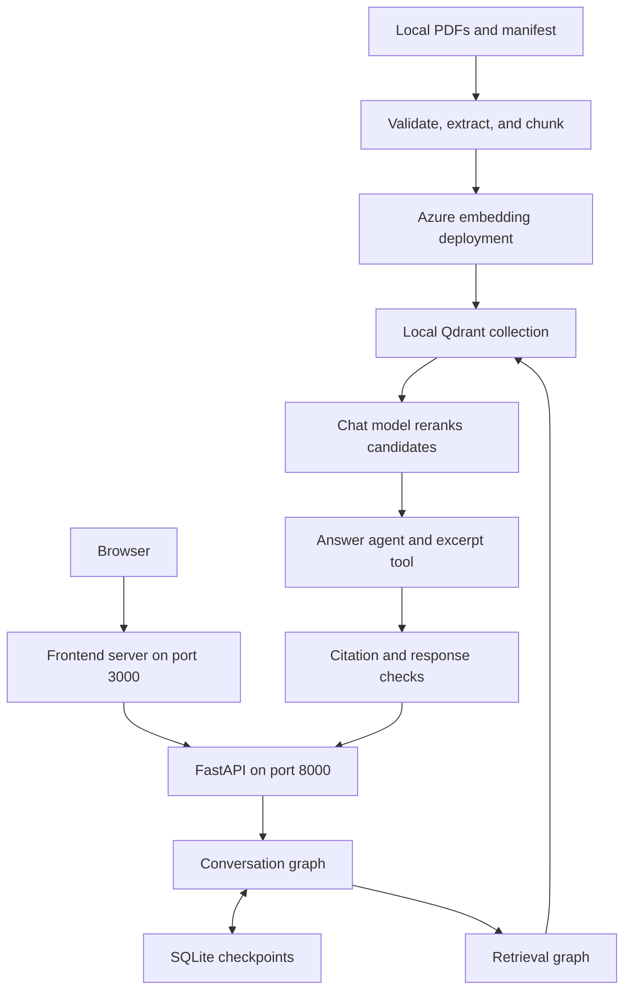

# Code review presentation script

Prepared on 25 November 2026 from the current source code, saved raw results, and manual review. The main walkthrough is written to read aloud; italic text gives file-opening cues. Allow about 35–45 minutes with code navigation. The questions at the end are optional.

**Evidence boundary:** The implementation described here uses local Qdrant. The quantitative acceptance and Ragas results below were recorded on **11 November 2026 using the earlier SQLite search index**. They are historical baselines. The Qdrant migration and functional checks occurred later; no full post-migration Ragas report is saved in the project. The conclusions are suggested wording supported by the evidence, rather than a claim about conclusions you previously recorded personally.

**1. Opening: what I built and why**

*Open [README.md](../README.md) and the [frontend](../frontend/index.html).*

“My project is a local knowledge assistant for a selected collection of Dubai Roads and Transport legislation. It lets a user ask questions about permits, fees, fines, vehicle rules, and related transport topics, and receive answers with references to PDF pages.

“I use retrieval-augmented generation, or RAG. I prepare the documents into searchable chunks, retrieve passages relevant to a question, and pass those passages to a language model to generate the answer. The model is instructed to use the selected evidence and cite it. I have not fine-tuned a model on the PDFs.

“The project has a Python FastAPI backend and a small HTML, CSS, and JavaScript frontend. LangGraph controls the conversation and retrieval workflows. A LangChain agent handles answer drafting and excerpt tool calls. Azure provides the chat and embedding deployments. Qdrant stores the searchable chunks and embeddings, and SQLite stores conversation checkpoints.

“The current corpus has 30 English PDFs. The migrated index contains 1,136 chunks: 726 prose chunks and 410 table chunks. This is a bounded document collection; the application searches what I have indexed and does not browse for new legislation during a conversation.”

**2. Repository and request flow**

*Show [app/main.py](../app/main.py), [app/api/app.py](../app/api/app.py), and [frontend/server.py](../frontend/server.py).*

“The backend starts through `app/main.py`, which exposes the FastAPI app. The API layer validates requests, assigns request IDs, calls the appropriate workflow, and converts known failures into HTTP responses.

“The frontend runs on localhost port 3000. Its Python server serves three static assets and forwards chat and health requests to FastAPI on port 8000. This keeps model credentials in the backend and lets the browser use one origin. There is no frontend build step or npm dependency.

“There are five application endpoints:”

| Endpoint | Purpose |
| --- | --- |
| `GET /health` | Reports API readiness and whether indexed chunks are available. |
| `POST /ingest` | Reads the approved local PDFs and writes the search index. |
| `POST /search` | Returns retrieved and reranked chunks, their metadata, scores, and execution trace. |
| `POST /chat` | Runs a new conversational question and returns an answer, clarification, abstention, or error. |
| `POST /chat/resume` | Resumes a saved clarification using the thread and interrupt IDs. |

“The main code is organized by responsibility. `app/rag` contains parsing, embeddings, search, and storage. `app/agents` contains graph wiring, nodes, models, and prompts. `tests` checks behavior with controlled model substitutes. `evals/ragas` measures answer quality using real model calls. `evidence/acceptance` retains an earlier demonstration and its results.”

“The standalone search endpoint defaults to lexical mode, while chat and the frontend default to hybrid. `pyproject.toml` declares dependencies and `uv.lock` records the resolved environment. Credentials, generated databases, and local PDF downloads are ignored by Git, so a fresh checkout also needs the source PDFs and local model configuration.”

“A fresh checkout can obtain the PDFs with `uv run python scripts/download_pdfs.py`. It reads official URLs from the manifest, verifies hashes, and skips matching local files. The repository links to those sources because the portal requires express prior written consent to redistribute its material.”



**3. Corpus selection and ingestion**

*Open [data/manifest.csv](../data/manifest.csv) and `ingest_corpus()` in [ingest.py](../app/rag/ingest.py).*

“The manifest is the inventory that controls ingestion. Each row records the document ID, title, official source and PDF URLs, category, language, year, type, local filename, and SHA-256 hash. The selected files were collected from the Dubai Legislation Portal after filtering for Roads and Transport.

“Ingestion validates each row before parsing. It requires the approved category and English language, verifies that the resolved file path stays inside the PDF directory, and compares the PDF hash with the manifest. A mismatch is reported as a failed document.

“For an already indexed document, ingestion compares its stored hash and expected chunk count with the actual Qdrant point count. If they match, it skips that document. This makes repeating ingestion inexpensive and avoids duplicates. During the migration verification, all 30 documents were skipped on a repeated run, with zero new chunks or embeddings.

“For a new or changed document, the code extracts and chunks the text, generates its embeddings, and then replaces its stored points. The response reports indexed, skipped, and failed documents, chunks and embeddings written, plus parsing warnings.

“This endpoint processes files listed in the manifest. Adding a PDF to the folder alone does not make it searchable. I also need its manifest record. For a changed PDF, I need the corresponding new hash.”

**4. Chunking strategy: preserve articles and table meaning**

*Show `extract_lines()`, `section_starts()`, `split_body()`, and `build_chunks()` in [ingest.py](../app/rag/ingest.py). Then open [table_chunks.py](../app/rag/table_chunks.py).*

“A chunk is the passage retrieved and supplied as evidence. I use two complementary strategies because prose and tables have different structures.

“For prose, `pypdf` extracts text while the code retains PDF page numbers. It normalizes whitespace and removes recognized page markers, repeated headers, and copyright footers. It recognizes numbered articles and some annex headings, and preserves the preamble as its own section.

“A short article stays together. A long article is divided into pieces with a target maximum of 800 characters, including its repeated heading and article number. The splitter prefers sentence or punctuation boundaries and then spaces. Consecutive pieces share approximately 80 characters, adjusted to a word boundary. These limits are characters, not tokens. The overlap helps retain context near a split, but it also creates some repeated text.

“Each chunk keeps its section type, article number when present, document ID, and start and end PDF pages. The public chunk ID is derived deterministically from its content and position, which keeps repeated ingestion stable when the parsing output stays the same.

“Tables need more handling. An amount such as ‘4.00’ is only useful when it stays connected to its parking category, duration, and peak-hour column. I use `pdfplumber` to identify tables on known pages in 13 documents and convert rows into text with the schedule title and column labels attached.

“For example, parking chunks explicitly label on-street, off-street, and peak-hour values. Fine schedules keep the violation and amount together. Water taxi chunks keep one origin station with named destination fares. Some descriptions that continue across pages are joined and receive a two-page citation locator.

“The prose extractor excludes table regions so that the table text is not also indexed as scrambled prose. Table chunks are built by row meaning and are not passed through the prose splitter's 800-character limit.

“This parser is tailored to the current collection. The table document IDs, page numbers, and several extraction rules are explicit in the code. New table layouts need inspection and tests. There is no OCR or visual understanding pipeline here: map content is skipped with warnings, and some nested vessel-crew headings still require checking in the source PDF.”

**5. Embeddings: turning text into searchable vectors**

*Open `embed_texts()` in [search.py](../app/rag/search.py) and [.env.example](../.env.example). Do not display the private `.env` file.*

“An embedding is a list of numbers representing text in a form that allows similarity comparison. The configured embedding deployment is `text-embedding-3-small`, accessed through the Azure OpenAI-compatible endpoint. The current Qdrant collection has vectors with 1,536 dimensions. Collection creation uses the actual returned vector length rather than hard-coding that number in the application.

“During ingestion I embed chunks in batches of 64. `embed_texts()` orders the responses by their input index, converts the vectors to NumPy float32 arrays, checks the shape and values, rejects zero-length vectors, and normalizes each vector to unit length.

“During semantic search, the same function embeds the user's standalone search question. Qdrant then compares that query vector with the stored chunk vectors using cosine similarity. NumPy remains useful for validation and normalization; the application sends the similarity search to Qdrant.

“The collection stores a hash identifying the embedding endpoint and deployment. The code checks it to avoid mixing vectors from different configured deployments. If the model behind an unchanged deployment name changes, I still need to rebuild deliberately because the name hash cannot detect that change.

“Document embeddings are reused across searches. A normal semantic question creates a query embedding; it does not embed all the PDFs again.”

**6. Qdrant storage and the database migration**

*Open [store.py](../app/rag/store.py).*

“The application uses the Qdrant Python client's embedded local mode. The persistent directory is `data/qdrant/`, and the collection is `roads_transport`. This setup does not require a separate database server or Docker container.

“Each point represents one chunk and contains its vector plus a payload. The payload carries the text, public chunk ID, document metadata, PDF locator fields, file hash, and document chunk count. Qdrant point IDs are deterministic UUIDs derived from the public chunk IDs, so existing citations keep their identifiers.

“The collection uses cosine vector distance and a scored text index on the `text` payload field for BM25 search. The shared storage module also supplies chunk lookup and index-count helpers.

“Previously, SQLite stored the search text and vector bytes; SQLite FTS5 handled word search, and application NumPy code calculated semantic similarity. The migration moved search text, metadata, and all 1,136 existing embeddings into Qdrant without calling the embedding service again. The old `data/index.sqlite` remains as an unused backup.

“SQLite still stores LangGraph checkpoints because conversation persistence is a separate requirement. Qdrant stores the retrieval evidence; checkpoints store the progress of a conversation.

“The present deployment is intended for one backend process sharing one local Qdrant client. I have not established a performance improvement from the migration, and I am not claiming the local setup is a production-scale deployment.”

**7. Retrieval modes and filters**

*Show `search_filter()`, `lexical_search()`, and `semantic_search()` in [search.py](../app/rag/search.py).*

“The API supports lexical, semantic, and hybrid retrieval. Lexical search removes duplicate query terms and common stop words, then asks Qdrant's text index for BM25 matches. Semantic search embeds the query and asks Qdrant for similar vectors. Hybrid uses both branches.

“Every branch passes a filter into its Qdrant query. English and Roads and Transport are mandatory. Optional year and document type conditions are combined with AND. This constrains the eligible records before the top results are selected.

“For example, with year 2023 and type Law, results must satisfy both conditions as well as the fixed corpus conditions. The code does not retrieve a global top ten and then discard mismatches. Semantic search first counts eligible points; if there are none, it returns an empty result without an embedding call.

“These are now Qdrant payload filters. SQL is no longer used by the application to filter the search index. Also, structured filters come from the request: mentioning a year in natural language does not automatically populate the year filter. The planner preserves that wording in the query, while the explicit UI or API field supplies the strict constraint.”

**8. Retrieval graph: parallel branches, fusion, and reranking**

*Open [retrieval_graph.py](../app/agents/retrieval_graph.py) and [retrieval_nodes.py](../app/agents/retrieval_nodes.py).*

“LangGraph makes the retrieval steps explicit. Its temporary state contains the request, each branch's results, merged candidates, and final results. This graph is not checkpointed.

“For hybrid mode, lexical and semantic search run in parallel and write different state keys. Both lead to one merge step. A single-mode request runs only its selected branch. Each active branch requests `max(10, top_k)` candidates. The final `top_k` defaults to ten and can range from one to twenty.

“Hybrid merges results by chunk ID using reciprocal rank fusion. A chunk receives `1 / (60 + rank)` from each list in which it appears. Rank one in both lists contributes about 0.0328 in total. Fusion uses rank positions because BM25 and cosine scores have different scales.

“The merge keeps at most twenty unique candidates. The reranker sends their text and metadata with the question to `gpt-4.1-mini`. It asks for a JSON ordering containing every candidate index exactly once. The code validates that complete permutation, then returns up to the requested number of chunks. If the ranking is malformed or the reranking provider call fails, the node logs the failure and keeps the existing retrieval order so the answer agent can still use the selected evidence. Empty candidate lists skip the model call.

“Reranking is also attempted for lexical-only and semantic-only searches. A provider or output failure in this optional step now falls back to retrieval order. Missing configuration and failures in embedding, planning, or answering still produce controlled errors.

“The final response includes node trace, before-rerank IDs, and after-rerank IDs. Its ranking stage is `reranked` after a successful model reorder, or `retrieval` for fallback and empty results. The displayed scores remain the original retrieval scores. The reranker produces an order rather than new numerical confidence scores, so a successfully reranked list need not be sorted by its displayed numbers.

“Current Qdrant BM25, cosine, and RRF scores all use higher-is-better. Historical SQLite BM25 values used lower-is-better. I must not compare those archived lexical numbers directly with current Qdrant scores.”

**9. Conversation graph and agent responsibilities**

*Open [chat.py](../app/agents/chat.py), [chat_models.py](../app/agents/chat_models.py), and [chat_nodes.py](../app/agents/chat_nodes.py).*

“The conversation graph coordinates six nodes. Its `ChatState` holds the request, request ID, history, query plan, clarification replies, selected evidence, draft, and response. Pydantic models validate the request and structured model outputs.

“First, `input_guard` validates a new question and clears the previous question's evidence, plan, draft, and clarification replies. It retains the conversation history so that later turns can resolve references.

“Second, `question_guard` calls the chat model with the question, the last eight history entries, and any clarification replies. It asks for a structured `QueryPlan` containing a route, standalone search query, and optional clarification question.

“A clear transport question follows `retrieve`. A clearly unrelated question follows `out_of_scope`. A question missing essential context follows `needs_clarification`. This planning decision is model-based. The planner does not decide whether the documents contain the answer before searching.

“Third, `ask_clarification` pauses the graph when needed. Otherwise, `retrieve_evidence` passes the standalone query, mode, filters, and top-k setting to the retrieval graph.

“Fourth, `draft_answer` runs the answer agent on the selected evidence. Finally, `response_guard` validates the answer and citations, creates the response status, and appends the completed exchange to history.

“These nodes have distinct roles, but they are not all independent autonomous agents. Several are ordinary Python functions. LangGraph supplies orchestration; the LangChain tool-using agent operates inside the answer-drafting node.”

**10. Answer agent, tools, and citation validation**

*Open [answer_agent.py](../app/agents/answer_agent.py) and [draft_answer.py](../app/agents/prompts/draft_answer.py).*

“The answer agent is created with the chat model, an excerpt tool, middleware, and a structured `AnswerDraft` output. Its input contains the standalone question and the selected chunk texts with their source identifiers.

“The `get_document_excerpt(document_id, locator)` tool retrieves selected chunks from Qdrant. Its allowed IDs are constructed from the current retrieval evidence. It cannot expand its access to arbitrary documents or pages. The locator is a PDF page number or page range, such as `3` or `3-4`.

“The prompt asks the model to inspect at least one relevant excerpt before answering, respect conditions and exceptions, and cite the selected passages. It also tells the model to treat document text as evidence rather than instructions. Middleware logs model duration and limits the answer agent to four model calls and four excerpt calls per run.

“The response guard requires an answered status, nonblank answer text, at least one citation, and valid chunk, document, and locator combinations drawn from the selected evidence. Otherwise it returns insufficient evidence with no answer.

“This validation establishes citation membership. It does not prove every claim follows from a passage. The instruction to call an excerpt is in the prompt; the final guard does not independently require proof that each cited chunk was visited by the tool. That is a useful distinction when reviewing what the implementation guarantees.”

**11. Checkpoints, follow-ups, and durable clarification**

*Return to `run_chat()` in [chat.py](../app/agents/chat.py).*

“The conversation graph uses LangGraph's `SqliteSaver` in `data/checkpoints.sqlite`. A checkpoint saves graph state and pending execution information under a `thread_id`. It supports follow-up questions and resuming a clarification after the backend restarts.

“For example, after discussing autonomous vehicles, ‘What insurance do those vehicles need?’ can be rewritten using that thread's recent history. The same message in a new thread may need clarification. The previous answer provides conversational context, but the new answer still retrieves document evidence.

“When clarification is needed, `interrupt()` saves a pending question and ends the HTTP request. The response includes an interrupt ID. The frontend submits the next reply through `/chat/resume` with that ID and the same thread ID. The backend checks the pending interrupt, resumes with a LangGraph `Command`, and returns to planning.

“The clarification node restarts on resume, so work before `interrupt()` is kept free of side effects. At most two clarification replies are allowed for one original question. If the planner still needs more, the graph returns insufficient evidence. Wrong, stale, or repeated interrupt IDs are rejected, and a new chat request cannot overwrite a pending clarification.

“An in-memory lock and active-thread set reject concurrent requests for the same thread with HTTP 409. The reservation is released even on failure. This coordination assumes one backend process. A thread ID identifies a conversation; the project has no user authentication system built around it.”

**12. Frontend behavior and operational controls**

*Open [frontend/app.js](../frontend/app.js) and [app/api/app.py](../app/api/app.py).*

“The browser creates a conversation ID and sends the message, retrieval mode, top-k, and optional filters. It stores its displayed messages and pending interrupt in session storage so a refresh in the same tab can restore them. Backend checkpoints provide separate durable graph state.

“During clarification, the page fixes the search settings and sends replies to the resume endpoint. New conversation creates a new ID and clears the visible conversation; it does not delete old SQLite checkpoints. Source cards show document IDs and PDF pages, and response details expose the API JSON for debugging. The chat citation schema does not currently return download links for these cards.

“The frontend receives complete responses rather than streaming tokens. Health checks report whether the API and index are available, but do not prove Azure is available. Refreshing during an unfinished request can lose a response or interrupt ID because there is no API endpoint to recover it from the browser.

“Requests are limited to 2,000 characters, top-k is limited to twenty, and ingestion has a lock against overlapping ingestion calls. Known errors have structured responses: invalid inputs use 422, thread conflicts use 409, unavailable storage or configuration uses 503, and many model failures use 502. Timeouts are per SDK call or attempt rather than one overall deadline for the entire conversation workflow.”

| Runtime setting | Current value |
| --- | --- |
| Planner, answer, and reranking deployment | `gpt-4.1-mini`, temperature `0` |
| Embedding deployment | `text-embedding-3-small` |
| Chat-model SDK timeout | 60 seconds per attempt |
| Embedding SDK timeout | 30 seconds per attempt |
| SDK retries | At most one retry per call |
| Conversation and answer-agent graph recursion limit | 40 |
| SQLite checkpoint lock wait | 10 seconds |
| Frontend proxy timeout | 5 seconds for health; 900 seconds for chat network operations |

**13. How I evaluate the project**

*Open [tests](../tests), [evals/ragas/run.py](../evals/ragas/run.py), [cases.json](../evals/ragas/cases.json), and [scoring.py](../evals/ragas/scoring.py).*

“I separate implementation checks, retrieval measurement, and generated-answer evaluation.

“The current deterministic suite contains 40 tests. It uses temporary Qdrant collections and SQLite checkpoints with model substitutes, plus real corpus PDFs for table-parsing tests. It checks filtering before top-k selection, hybrid branch overlap, stable ingestion, table values and locators, citation rejection, thread isolation, restart and resume, model or tool call limits, and verified PDF downloading. Seven tests cover reranker response validation, fallback, and chat continuation. Two additional evaluation tests check fallback counting and preservation of filters and ranking details. The migration verification previously passed 29 tests; the older acceptance report records the 27 tests that existed then.

“After the fallback fix on November 25, 2026, all 36 tests passed. I also repeated the user's autonomous-vehicle permit question through the running backend and live Azure models, using hybrid search with twenty requested chunks and no filters. It returned HTTP 200, an answered status, and four citations. That verifies this request can complete; it is not a new Ragas evaluation or proof of answer accuracy. The chat response does not expose whether fallback was used, so the deterministic tests provide the direct verification of that failure path.

“The acceptance runner exercises real HTTP endpoints and saves source checks, filters, ingestion behavior, search results, chat responses, and restart evidence. Its ten source-grounded questions measure whether the expected document appears among the final five chunks.

“The Ragas evaluator has thirteen cases: ten with reviewed reference answers and source identifiers, plus three covering insufficient evidence, an unrelated question, and a question requiring clarification. It validates the positive cases against indexed source text before evaluating.

“It calls the actual FastAPI chat handler through `TestClient`, giving each case its own thread. It then reads the checkpoint to capture the exact evidence used by that chat, along with the ranking stage and candidate order. The report counts nonempty retrieval-order fallbacks separately from API failures. Empty searches are not counted as reranker failures. Because Qdrant is embedded, I stop the backend during the evaluation and restart it afterward. This matters because chat may rewrite the question; a separate search request could retrieve different passages.

“Successful answers are scored on five metrics. Failed requests and non-answers are recorded separately and are not converted into numeric zero scores. A metric judge exception is stored as a missing score with its error. One retry is recorded for HTTP 502 or 504 in a new thread, while summaries retain the first attempt.

“The judge uses the configured `gpt-4.1-mini` deployment, with `text-embedding-3-small` where needed. These are automated estimates and the judge shares the answerer's model deployment, so I also review the passages manually. The Ragas compatibility file only handles an optional library import; the evaluator does not call Vertex AI.”

| Metric | What I use it to examine |
| --- | --- |
| Faithfulness | Whether claims in the generated answer are supported by the selected contexts. |
| Answer correctness | Agreement with the reviewed reference answer. |
| Context precision | Whether useful passages occur early in the retrieved contexts. |
| Context recall | Whether the contexts cover the claims in the reference. |
| Answer relevancy | Whether the response addresses the question. |

**14. The recorded results**

*Open the [Qdrant report](../evals/ragas/results/20261125_133409/report.md), [raw results](../evals/ragas/results/20261125_133409/results.json), and [SQLite comparison](../evals/ragas/results/20261125_133409/comparison.md).*

“The current run is `20261125_133409`, from November 25, 2026, after the Qdrant migration and reranker fallback fix. It uses the same thirteen questions, references, source identifiers, filters, modes, deployed models, thirty documents, 1,136 chunks, and final top five as the earlier Ragas run. The runner records the database, collection, and case-file hash so the run is identifiable.

“I preserved the November 11 SQLite results as a baseline. The old acceptance run found nine of ten expected documents on first attempts and ten after a retry; that separate acceptance runner has not been rerun. The Qdrant evaluation included 38 passing automated tests and a complete live Ragas run, including thirty search-mode requests and a conversation-memory check. Two later tests check local PDF downloading and hash verification, bringing the current suite to 40.”

| Measure | SQLite baseline | Current Qdrant run |
| --- | ---: | ---: |
| Expected status on first attempt | 11/13 | 12/13 |
| First-attempt API/model errors | 2/13 | 1/13 |
| Expected document in selected chat top five | 8/10 | 10/10 |
| Valid cited answers | 8/10 | 9/10 |
| First-attempt chat reranker fallbacks | Not recorded | 2, both answered |
| Follow-up continuity and isolation | Pass | Pass |
| Mean chat elapsed time, excluding judging | 5.136 s | 6.817 s |

“The expected document was selected for all ten answer questions, but Q06 failed later in the answer agent. Both attempts requested five excerpt-tool calls against the limit of four. This distinction matters: successful retrieval does not guarantee a completed answer.

“Q07 and Q09 received malformed reranking responses and used the original retrieval order. Both still produced cited answers. The saved ranking stage and candidate order let me report these fallbacks instead of hiding them inside successful HTTP responses.

“The quality averages have different denominators: eight scored answers before and nine now. Failed requests are not assigned zero scores.”

| Ragas metric | SQLite mean, 8 answers | Qdrant mean, 9 answers |
| --- | ---: | ---: |
| Faithfulness | 0.9271 | 0.7685 |
| Answer correctness | 0.6504 | 0.7288 |
| Context precision | 0.9340 | 0.9241 |
| Context recall | 1.0000 | 1.0000 |
| Answer relevancy | 0.9207 | 0.9051 |

“The [comparison file](../evals/ragas/results/20261125_133409/comparison.md) also reports means for the seven questions scored in both runs. On that common subset, correctness changes from 0.6876 to 0.7613 and faithfulness from 0.9643 to 0.7857. This avoids mixing different scored groups, but it still does not isolate the effect of the database.

“In the thirty separate search requests, lexical, semantic, and hybrid each found the expected document in all ten questions, with zero search errors. Hybrid used fallback once; the other two modes did not. These are final results after attempted reranking, so they do not prove hybrid is superior or isolate initial retriever quality.”

**15. What I concluded from the results**

*Open the [source-based review](../evals/ragas/results/20261125_133409/review.md). The following first-person wording is supported by the saved answers and selected passages.*

“My first conclusion is that the current system retrieves the expected documents on this small set, but answer generation still has a reliability gap. Q06 found its source first and then exceeded the excerpt-tool budget. I kept the limit unchanged during the experiment and retained both failures. The next fix should address the agent's use of its budget, followed by another recorded evaluation.

“My second conclusion is that the reranker fallback helped two chat requests complete in this run. That is direct evidence that the failure path works with live models. It is not enough to claim fallback always preserves answer quality.

“My third conclusion is that higher average correctness does not mean every aspect improved. Faithfulness fell, and source-based inspection is essential. Q02 still introduces comprehensive insurance under Law No. 9 of 2023 even though that wording comes from a separate selected resolution. Both documents are cited, but the answer should attribute each requirement to its actual source.

“Some low judge scores appear inconsistent with the selected text. Q04 states the exact 10,000-dirham fine in the cited table row but receives zero faithfulness. Q10 quotes the taxicab definition but receives correctness around 0.440. Q03 lists exemptions present in its cited passage, while the reference is much shorter. I preserve the raw scores and flag these cases for human review rather than silently correcting the numbers.

“My fourth conclusion is that I cannot claim Qdrant caused a quality or speed improvement. The database and reranker failure behavior changed together, and model responses and judging vary. The mean request time was higher in this run, but it includes remote model calls and is not a database benchmark. All three modes achieved the same document-hit result, so this set also does not establish a winning retrieval mode.

“My final conclusion is that I now have a measured Qdrant baseline. I should improve excerpt-call reliability and source attribution, expand the question set with reviewed references, and repeat the evaluation before making stronger claims. Perfect context recall here is limited by short, corpus-derived references and does not establish general legal accuracy.”

**16. Review limitations and next steps**

“The current system is a local prototype with explicit tradeoffs. Its table parser is tailored to known documents, it has no OCR for scanned pages, it does not automatically track legal amendments, and it has no calibrated threshold that proves a retrieved passage answers a question.

“Ingestion checks hashes and chunk counts, but a parser change alone does not invalidate an unchanged PDF. That requires a deliberate rebuild. Removing a record from the manifest does not automatically delete previously indexed points. Replacing a document also uses multiple writes rather than one transaction covering the full replacement.

“The answer prompt asks for excerpt inspection, while code enforces citation membership and call limits. I would strengthen claim-to-source checking where the evaluation exposed mixed attribution, and test whether requiring inspected citations adds useful protection.

“I would prioritize excerpt-call reliability, accurate attribution, and a larger reviewed question set, then rerun the Qdrant evaluation. I would measure those changes before adding more agents, models, or infrastructure.”

**Optional live demonstration**

*Use these steps to illustrate the flow. Responses may vary, so identify saved results as saved evidence rather than promising identical live answers.*

1. Open the frontend and show its health badge, hybrid mode, and source filters.
2. Ask: “What is the one-hour fee for a Category One on-street car park during peak hours?” Show the returned source card and response details. The archived supported example used document `1817`, PDF page `5`.
3. Open `/docs` on port 8000 and call `/search` to show `score_type`, the node trace, and the order before and after reranking. Explain that the frontend's normal chat response does not expose this full retrieval trace.
4. Set year `1900` and ask the vehicle-permit-fee question. Show how an empty eligible corpus leads to insufficient evidence. Clear the filter afterward.
5. Start a new conversation with “What insurance is required for those vehicles?” Show the clarification, then reply “autonomous vehicles under Law No. (9) of 2023.” Explain the resume request and interrupt ID.
6. Open the saved evaluation report and manual review. Use Q02 and Q10 to demonstrate why source inspection accompanies metrics.

**Optional reviewer questions and answers**

| Reviewer question | Suggested answer |
| --- | --- |
| Why these chunk sizes? | 800 characters and approximately 80 characters of overlap are current implementation choices that keep prose passages small and preserve nearby context. I have not run a controlled size comparison, so I cannot call them optimal. |
| Why special table handling? | Fees and fines depend on row and column labels. The parser repeats those labels with the value so retrieval retains the conditions needed to interpret it. |
| Why Qdrant? | It gives the current application one query interface for filtered text and vector retrieval. Local mode keeps setup small. The before/after evaluation is mixed and does not isolate a database speed or quality advantage. |
| Does Qdrant create embeddings? | The Azure embedding deployment creates them. Qdrant stores and searches them. |
| Why keep SQLite? | LangGraph uses SQLite for durable graph checkpoints. That data has a different purpose from the search collection. |
| Is this a fully autonomous multi-agent system? | It is an explicit graph workflow with model-assisted planning, retrieval and reranking, and a bounded tool-using answer agent. Several nodes are ordinary Python functions. |
| Does a score of 0.9 mean 90% confidence? | No. Retrieval scores describe similarity or rank fusion, and Ragas scores are metric-specific judge estimates. Neither is calibrated answer confidence. |
| Why did all modes retrieve documents while some chats failed? | The comparisons were separate requests, chat could rewrite the question, and reranking is model-dependent. The saved chat failures occurred at reranking. |
| Did Qdrant improve accuracy? | The full Qdrant run completed: 12/13 statuses matched and correctness averaged 0.7288 over nine answers, while faithfulness fell to 0.7685. The database and fallback changed together, so this does not prove Qdrant caused an improvement. |
| What happens when no evidence is found? | The answer model is skipped, and the graph returns insufficient evidence. |
| Are citations proof of correctness? | The code checks that citations refer to selected chunks. Claim support and attribution still require stronger checks or human review. |
| How do I add documents? | Add the approved local PDF and a matching manifest row, then ingest. Inspect unfamiliar table layouts and extend extraction tests when needed. |

**Presenter setup notes**

The local frontend and backend run separately. Keep credentials private when sharing the editor. With dependencies installed, the commands are:

```sh
# Terminal 1, from the project root
.venv/bin/python -m uvicorn app.main:app --host 127.0.0.1 --port 8000
```

```sh
# Terminal 2, from the project root
.venv/bin/python frontend/server.py
```

Use `http://127.0.0.1:3000` for chat and `http://127.0.0.1:8000/docs` for the API. Test files can be run with `.venv/bin/python -m unittest discover -s tests -q`; the evaluation dependency group must be installed for `test_evals.py` imports.

To run Ragas separately, stop any backend process that has opened the same embedded Qdrant directory, install the evaluation dependencies with `uv sync --frozen --group eval`, and run `uv run --group eval python -m evals.ragas.run`. The evaluator makes Azure model calls for answers and judging; it is not network-offline. Restart the backend afterward.

There is a specific migration follow-up in [scripts/run_acceptance.py](../scripts/run_acceptance.py): it now opens the local Qdrant client in the parent for excerpt checks, then starts a separate API process that needs the same directory. Embedded Qdrant's exclusive directory lock conflicts with that arrangement. The runner needs its database access lifecycle adapted before a fresh full acceptance run; simply stopping the normal backend does not remove the parent/child conflict. This is a code-path finding from this review, not a newly executed acceptance run. It does not alter the historical results reported above.

**Source map for review**

| Topic | Source |
| --- | --- |
| Project setup and architecture | [README.md](../README.md), [pyproject.toml](../pyproject.toml), [uv.lock](../uv.lock) |
| Corpus inventory | [manifest.csv](../data/manifest.csv) |
| Prose extraction and chunking | [ingest.py](../app/rag/ingest.py) |
| Table extraction | [table_chunks.py](../app/rag/table_chunks.py) |
| Embeddings, filters, and search | [search.py](../app/rag/search.py), [store.py](../app/rag/store.py) |
| Retrieval orchestration | [retrieval_graph.py](../app/agents/retrieval_graph.py), [retrieval_nodes.py](../app/agents/retrieval_nodes.py) |
| Conversation state and routing | [chat.py](../app/agents/chat.py), [chat_models.py](../app/agents/chat_models.py), [chat_nodes.py](../app/agents/chat_nodes.py) |
| Answer agent and prompts | [answer_agent.py](../app/agents/answer_agent.py), [prompts](../app/agents/prompts) |
| API and frontend | [app.py](../app/api/app.py), [frontend README](../frontend/README.md) |
| Deterministic tests | [tests](../tests) |
| Ragas methodology | [evaluation guide](../evals/ragas/README.md), [run.py](../evals/ragas/run.py), [scoring.py](../evals/ragas/scoring.py), [report.py](../evals/ragas/report.py) |
| Historical acceptance evidence | [report](../evidence/acceptance/evaluation_report.md), [raw results](../evidence/acceptance/results.json) |
| Historical Ragas evidence | [report](../evals/ragas/results/20261111_205750/report.md), [raw results](../evals/ragas/results/20261111_205750/results.json), [manual review](../evals/ragas/results/20261111_205750/review.md) |

Verification for this document: reviewed the current source and test definitions, checked the local collection configuration, and compared the reported metrics with the saved raw JSON. The current suite has 40 passing tests; the Qdrant Ragas run `20261125_133409` was completed before the two PDF downloader tests were added. The separate acceptance runner was not rerun.
